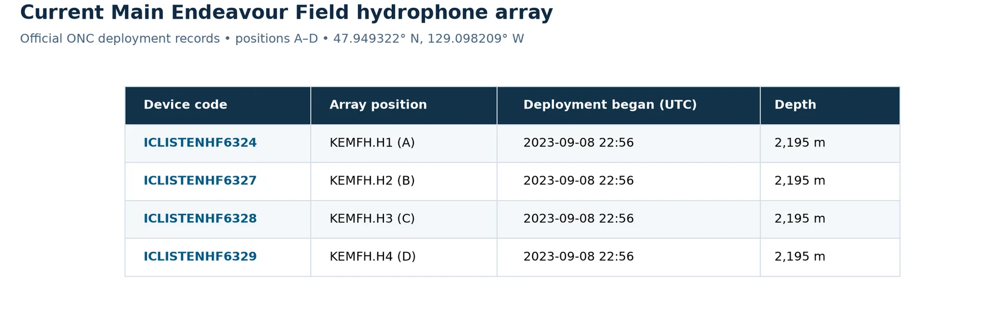
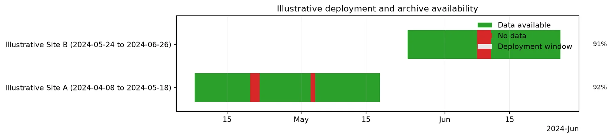
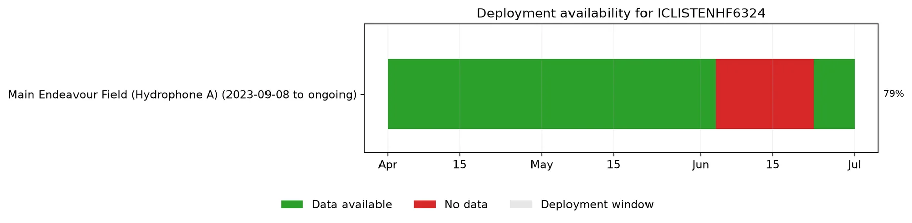
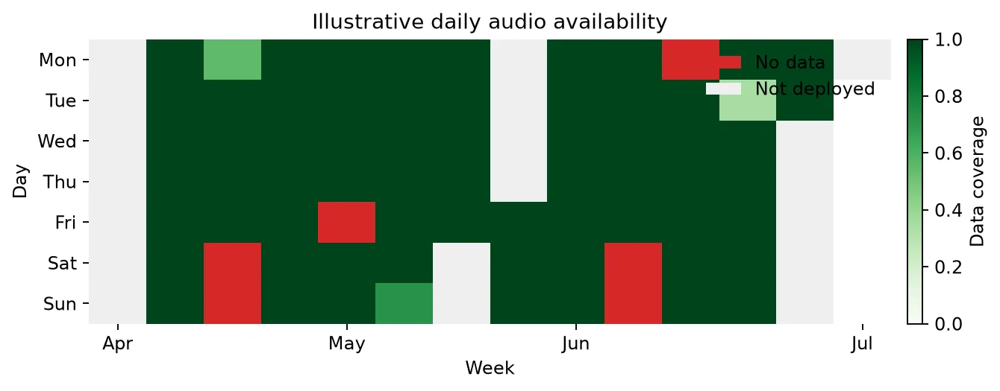

# 2. Find a Hydrophone and Valid Dates

Three identifiers matter when choosing data:

- a **device code** names one instrument, such as `ICLISTENHF6324`;
- a **location code** names where it is installed, such as `KEMFH.H1`;
- a **deployment** is the period one device spent at one location.

Confirm all three before downloading. A valid device code still returns no
files for dates outside its deployments or during an archive gap.

## List hydrophones and their deployments

`print_hydrophone_overview()` prints every hydrophone with its location code,
location, deployment period, depth, and coordinates. Pass
`current_only=True` to list only the hydrophones deployed right now:

```python
from onc_hydrophone_data.data.deployment_checker import (
    HydrophoneDeploymentChecker,
)
from onc_hydrophone_data.onc.common import load_config

onc_token, _ = load_config()
checker = HydrophoneDeploymentChecker(onc_token)

# Hydrophones deployed right now.
checker.print_hydrophone_overview(current_only=True)
```

The output begins like this (an excerpt of ONC's records on 2026-10-22; run the
command for the current list):

```text
36 hydrophones deployed now at 16 sites (as of 2026-10-22 21:56 UTC)

Location code  Device code                 Begin       End      Depth (m)  Latitude  Longitude  Location
-------------  --------------------------  ----------  -------  ---------  --------  ---------  ----------------------------------------------------------
BACNH.H1       ICLISTENHF6095              2021-02-10  ongoing        641   48.3452  -126.1573  Barkley Node (Hydrophone A)
BACNH.H2       ICLISTENHF6094              2021-02-10  ongoing        641   48.3452  -126.1573  Barkley Node (Hydrophone B)
BACNH.H3       ICLISTENHF6093              2021-02-10  ongoing        641   48.3452  -126.1573  Barkley Node (Hydrophone C)
BACNH.H4       ICLISTENHF6092              2021-02-10  ongoing        641   48.3452  -126.1573  Barkley Node (Hydrophone D)
BACUS          ICLISTENAF2534              2024-06-26  ongoing        393   48.4267  -126.1744  Upper Slope South
BIIP           ICLISTENHF1354              2025-01-25  ongoing         24   49.3010  -123.1125  Burrard Inlet Underwater Network
...
KEMFH.H1       ICLISTENHF6324              2023-09-08  ongoing       2195   47.9493  -129.0982  Main Endeavour Field (Hydrophone A)
KEMFH.H2       ICLISTENHF6327              2023-09-08  ongoing       2195   47.9493  -129.0982  Main Endeavour Field (Hydrophone B)
...
```

To include completed deployments, call it without `current_only`. Rows are
sorted by location code and then begin date, so each site's history reads in
order:

```python
checker.print_hydrophone_overview()
```

| Column | What it tells you |
| --- | --- |
| `Location code` | ONC's code for the installation. A suffix such as `.H1` marks one hydrophone position at a site, such as one element of an array. |
| `Device code` | The value to pass as `device_code` to the download methods |
| `Begin` / `End` | The deployment period in UTC. Request data only inside it. `ongoing` means ONC lists no end date. |
| `Depth (m)`, `Latitude`, `Longitude` | Where the hydrophone was during that deployment |
| `Location` | The site name, with the array position in parentheses |

The same listing is available from a repository checkout without writing
Python:

```bash
python scripts/download_hydrophone_data.py --mode overview --current-only
```

### Hydrophone arrays

Some sites have several hydrophones mounted together. Each array position has
its own location code and device code. For example, these are the four
hydrophones of the Main Endeavour Field array:

{: width="100%" loading="lazy" }

*Source: [ONC Hydrophone Location Codes & Data Types](https://wiki.oceannetworks.ca/spaces/O2KB/pages/72548584/ONC+Hydrophone+Location+Codes+Data+Types),
accessed 2026-07-14.*

## Filter or save the list

`get_hydrophone_overview()` returns the same rows as a pandas DataFrame, one
row per deployment. Use it to narrow the list or save it:

```python
overview = checker.get_hydrophone_overview()
columns = ["location_code", "device_code", "begin_date", "end_date", "location_name"]

# One instrument's deployment history.
history = overview[overview["device_code"] == "ICLISTENHF6324"]
print(history[columns].to_string(index=False))

# Every hydrophone deployed at one site, oldest first.
site = overview[overview["location_name"] == "Main Endeavour Field"]
print(site[columns].to_string(index=False))

# Only the hydrophones deployed now.
current = overview[overview["currently_deployed"]]

# Save the full list for a spreadsheet.
overview.to_csv("onc_hydrophone_deployments.csv", index=False)
```

The site query prints records like these (excerpt):

```text
location_code    device_code                begin_date                  end_date        location_name
         KEMF ICLISTENHF1561 2018-07-25 18:03:48+00:00 2020-10-03 02:53:21+00:00 Main Endeavour Field
         KEMF ICLISTENHF1950 2020-06-11 16:25:38+00:00 2020-06-12 23:34:59+00:00 Main Endeavour Field
...
     KEMFH.H1 ICLISTENHF6324 2023-09-08 22:56:13+00:00                       NaT Main Endeavour Field
     KEMFH.H2 ICLISTENHF6327 2023-09-08 22:56:13+00:00                       NaT Main Endeavour Field
```

The DataFrame also has `device_name`, `device_id`, `position_name`,
`location_path` (the full ONC location hierarchy), and `doi`, the DOI from
ONC's data citation for each deployment. Dates are timezone-aware UTC values;
`end_date` is empty (`NaT`) while a deployment is ongoing. In a notebook, end a
cell with a filtered DataFrame such as `site[columns]` to display it as a
table.

A site's history often spans several instruments. These real ONC records show
older single-hydrophone deployments at Main Endeavour Field followed by the
four-position array that includes `ICLISTENHF6324`:

{: width="100%" loading="lazy" }

The [official ONC inventory](https://wiki.oceannetworks.ca/spaces/O2KB/pages/72548584/ONC+Hydrophone+Location+Codes+Data+Types)
listed no end date for the four array deployments when accessed on 2026-07-14,
meaning they were ongoing in that source snapshot.

## Confirm archive availability

A deployment window means the instrument was installed; it does not guarantee
that every hour has an archived audio file. Query a modest date range and plot
daily coverage:

```python
availability = checker.get_device_availability(
    "ICLISTENHF6324",
    start_date="2024-04-01",
    end_date="2024-07-01",
    timezone_str="UTC",
    bin_size="day",
)
```

!!! note
    Availability queries inspect ONC archive listings. Start with weeks or a
    few months rather than the instrument's entire history.

### Timeline view

```python
from onc_hydrophone_data.utils import plot_deployment_availability_timeline

timeline_fig, _ = plot_deployment_availability_timeline(
    availability,
    show=False,
)
timeline_fig.savefig(
    "availability_timeline.png",
    dpi=170,
    bbox_inches="tight",
)
```

{: width="100%" loading="lazy" }

The availability result distinguishes archived data, gaps during a deployment,
and dates when the device was not deployed. Coverage is the duration for which
merged archived audio intervals overlap each daily bin, divided by the bin's
total duration.

### Calendar view

```python
from onc_hydrophone_data.utils import plot_availability_calendar

calendar_fig, _ = plot_availability_calendar(
    availability,
    show=False,
)
calendar_fig.savefig(
    "availability_calendar.png",
    dpi=170,
    bbox_inches="tight",
)
```

{: width="100%" loading="lazy" }

Each calendar value is the fraction of that day covered by archived audio time
intervals. A zero value within a deployment is an archive gap; dates outside a
deployment are recorded separately rather than treated as missing data.

!!! info "Real archive result"
    Both plots above were generated on 2026-07-14 by running the documented
    query for `ICLISTENHF6324` from 2024-04-01 through 2024-07-01. ONC returned
    91 daily bins: 72 with archived data and 19 without data, covering
    2024-06-04 through 2024-06-22. Historical results can change if ONC
    reprocesses its archive, so rerun the commands when current status matters.

## Carry your choice into the download

Write down:

1. the `device_code`;
2. a UTC start time inside a green interval;
3. a UTC end time a few minutes later for your first test.

Continue to **[3. Download Audio and Make a Spectrogram](quickstart.md)** with
those values.
